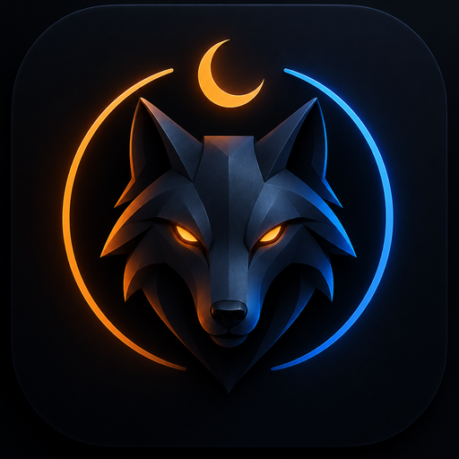

<div align="center">
  
  <h1>Noctwolf</h1>
  <p><strong>We're Wolves!</strong></p>
  <p>A local-network Werewolf / Loup-Garou game for Android.</p>
</div>

## Download

[Download the latest APK](https://github.com/99yasopp/noctwolf/releases/latest)

- Android 7.0 or newer
- Version 1.0.1
- APK size: 73 MB
- SHA-256: `d755c66f4792799f96b0ae8324881d4bdea082b3da31a0123fc94b02a80f21c0`

The APK is attached to a GitHub Release. It is not committed to Git history.

## What it is

Noctwolf runs a full game of Werewolf from one Android phone. The host phone is the server. Other players join from the Android app or from a browser on the same Wi-Fi.

Features:

- Local-network hosting and joining
- Narrator dashboard for phases, votes, night actions and timers
- Classic and custom role setups
- Quick table, ghost table and seer dossier
- Optional AI role generation with your own DeepSeek or OpenAI key
- English, French and Arabic, including Arabic RTL layout

No account is required. Games stay on the local network. AI role generation is optional and uses the API key you provide.

## How to play

1. Install the APK on the Android phone that will host the game.
2. Put all players on the same Wi-Fi network.
3. Open Noctwolf and host a table.
4. Other players join from the app or from a browser on the same network.

Android may ask you to allow installing apps from your browser or file manager. That is normal for a direct APK release.

## Build from source

Requirements: Node.js 22+, Java 17, Android SDK.

```bash
npm install
npx expo start
```

To run on a connected Android device or emulator:

```bash
npx expo run:android
```

## Build a release APK

```bash
npx expo prebuild --platform android
cd android
./gradlew assembleRelease
```

The APK is written to:

```text
android/app/build/outputs/apk/release/app-release.apk
```

Release signing uses `android/keystore.properties` locally. That file and the keystore are gitignored. EAS Build uses the credentials configured in the Expo project.

## Build with EAS

```bash
npx eas-cli build --platform android --profile preview
```

The `preview` profile builds an APK. The `production` profile builds an AAB for Google Play.

## Source and downloads

- Download page: https://99yasopp.github.io/noctwolf/
- Releases: https://github.com/99yasopp/noctwolf/releases
- Issues: https://github.com/99yasopp/noctwolf/issues

## Stack

Expo SDK 58 · React Native 0.88 · React 19 · TypeScript · Android compileSdk 37 / targetSdk 36
